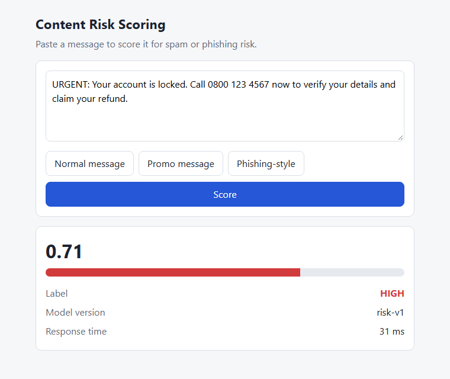

# コンテンツ・リスク判定サービス

[English](README.md) | 日本語

[](https://github.com/Karthik0000007/Risk_Scoring_System/actions/workflows/ci.yml)

これは、テキストのメッセージがスパムやフィッシングかどうかを判定する、小さな FastAPI のサービスです。`POST /score` にテキストを送ると、0 から 1 までのリスクスコアが返ってきます。スコアは、SMS Spam Collection というデータで学習した TF-IDF とロジスティック回帰のモデルが計算します。予測の途中でエラーが起きたときは、500 エラーを返さずに、キーワードのルールでスコアを出します。そのときは、レスポンスに `degraded: true` が付きます。起動のときにモデルが読み込めなかった場合は、`/readyz` と `/score` が 503 を返すので、そのインスタンスにはリクエストが送られません。ほかに、1 ページの Web 画面、Prometheus のメトリクス、Dockerfile、Docker Compose、Kubernetes のマニフェスト、GitHub Actions の CI があります。



---

## 目次

- [すぐに動かす](#すぐに動かす)
- [API](#api)
- [モデル](#モデル)
- [失敗したときの動き](#失敗したときの動き)
- [設計の判断](#設計の判断)
- [パフォーマンス](#パフォーマンス)
- [次に改善したいこと](#次に改善したいこと)
- [ファイル構成](#ファイル構成)

---

## すぐに動かす

Docker と Compose v2 が必要です。

```bash
docker compose up --build
```

| サービス | URL | 内容 |
| :--- | :--- | :--- |
| `app` | [http://localhost:8000](http://localhost:8000) | 判定 API と Web 画面 |
| `prometheus` | [http://localhost:9090](http://localhost:9090) | Prometheus。5 秒ごとにアプリのメトリクスを集めます |

`app` コンテナのヘルスチェックは `/readyz` を呼びます。モデルが読み込まれるまで、`docker compose ps` では `healthy` になりません。Prometheus は、そのあとで起動します。止めるときは `Ctrl+C` を押してから、`docker compose down` を実行します。

### Docker を使わない場合

```bash
python -m venv .venv
source .venv/bin/activate          # Windows PowerShell: .\.venv\Scripts\Activate.ps1
pip install -r requirements.txt
uvicorn app.main:app --port 8000
```

ブラウザで [http://localhost:8000](http://localhost:8000) を開くか、次のコマンドを実行します。

```bash
curl -X POST http://localhost:8000/score \
     -H "Content-Type: application/json" \
     -d '{"content": "URGENT: Your account is locked. Call 0800 123 4567 now."}'
```

### テストと lint

```bash
pip install -r requirements-dev.txt
ruff check .
pytest
```

CI（[`.github/workflows/ci.yml`](.github/workflows/ci.yml)）は、push と pull request のたびに同じ `ruff check` と `pytest` を実行し、そのあとで Docker イメージをビルドします。どれか一つでも失敗すると、CI 全体が失敗します。

### Kubernetes

[`k8s/`](k8s/) のマニフェストで、次のものを作ります。

- `content-risk-staging` という namespace
- レプリカ 1 つの Deployment（CPU 200m から 500m、メモリ 512Mi から 1Gi。liveness は `/healthz`、readiness は `/readyz`）
- ポート 80 の ClusterIP Service

イメージはローカルの `content-risk-scoring:latest` を使います。先にイメージをビルドして、クラスタに読み込んでください（例: `kind load docker-image content-risk-scoring:latest`）。

```bash
docker build -t content-risk-scoring:latest .
kubectl apply -f k8s/namespace.yaml -f k8s/deployment.yaml -f k8s/service.yaml
kubectl get pods -n content-risk-staging
```

---

## API

### `POST /score`

リクエスト:

```json
{ "content": "Get 50% off all shoes this weekend only! Reply STOP to opt out." }
```

`content` は 1 文字から 5000 文字までの文字列です。

レスポンス:

```json
{
  "risk_score": 0.6412835639663655,
  "risk_label": "HIGH",
  "model_version": "risk-v1",
  "degraded": false
}
```

| フィールド | 意味 |
| :--- | :--- |
| `risk_score` | テキストがスパムである確率。0.0 から 1.0 |
| `risk_label` | `LOW`（0.3 未満）、`MEDIUM`（0.3 から 0.6）、`HIGH`（0.6 より大きい）。すべての判定が失敗したときは `UNKNOWN` |
| `model_version` | 通常は `risk-v1`。キーワードのルールで判定したときは `keyword-fallback-1.0` |
| `degraded` | モデルが失敗して、キーワードのルールが答えたときに `true` |

ステータスコード:

| コード | いつ | ボディ |
| :--- | :--- | :--- |
| `200` | モデル、またはキーワードのルール（`degraded: true`）で判定できたとき | 上のレスポンス |
| `422` | 入力が正しくないとき（空、5000 文字より長い、`content` がない、JSON ではない） | FastAPI の検証エラー `{"detail": [...]}` |
| `503` | 起動のときにモデルが読み込めなかったとき | `{"detail": "model not loaded"}` |

### その他のエンドポイント

| エンドポイント | 返すもの |
| :--- | :--- |
| `GET /` | 1 ページの Web 画面（[`app/static/index.html`](app/static/index.html)）。HTML、CSS、JavaScript だけで作っています |
| `GET /healthz` | プロセスが動いていれば、いつも `200 {"status": "ok"}`（liveness） |
| `GET /readyz` | モデルが読み込まれていれば `200 {"ready": true, "model_version": "risk-v1"}`。読み込まれていなければ `503 {"ready": false, "reason": "..."}`（readiness） |
| `GET /metrics` | Prometheus のメトリクス（下の表） |

| メトリクス | 種類 | ラベル | 意味 |
| :--- | :--- | :--- | :--- |
| `http_requests_total` | Counter | `method`, `path`, `status` | 処理したリクエストの数 |
| `http_request_latency_seconds` | Histogram | `path` | リクエストの処理時間 |
| `predictions_total` | Counter | `label` | `/score` のレスポンスの数（リスクのラベルごと） |
| `fallback_total` | Counter | なし | モデルが失敗して、キーワードのルールで判定した数 |
| `model_loaded` | Gauge | なし | 起動のときにモデルが読み込めたら `1`、読み込めなかったら `0` |

`path` ラベルには、実際の URL ではなく、ルートのテンプレート（例: `/score`）を使います。こうすると、ラベルの種類が増えすぎません。知らない URL はすべて `unmatched` になります。`/metrics` へのリクエストは数えません。ログは、1 行に 1 つの JSON として標準出力に出ます。

---

## モデル

[`training/train.py`](training/train.py) は scikit-learn のパイプラインを学習します。`TfidfVectorizer`（1 語と 2 語の組み合わせ）のあとに `LogisticRegression` が続きます。データは UCI の [SMS Spam Collection](https://archive.ics.uci.edu/dataset/228/sms+spam+collection) で、`spam` を「リスクあり」として扱います。データは、スパムの割合を保ったまま、学習用 80%、テスト用 20% に分けます。乱数のシードは 42 に固定しています。

```bash
# SMSSpamCollection ファイルを data/ に置いてから（data/ は git に入れません）:
python training/train.py
```

学習したパイプラインは `models/risk-v1.joblib` に、メタデータは [`models/risk-v1.json`](models/risk-v1.json) に保存されます。どちらもリポジトリに入っているので、もう一度学習しなくてもサービスは動きます。サービスは、モデルの場所を環境変数 `MODEL_PATH` から読みます（デフォルトは `models/risk-v1.joblib`）。バージョンは JSON ファイルから読みます。

`models/risk-v1.json` の結果（スパムのクラス、テスト用の 1,115 件）:

| バージョン | 学習日 | 件数 | 適合率 (Precision) | 再現率 (Recall) | F1 |
| :--- | :--- | ---: | ---: | ---: | ---: |
| `risk-v1` | 2026-11-25 | 5,574 | 1.00 | 0.75 | 0.86 |

テストデータでは、普通のメッセージをスパムと間違えたことは 0 件でした。でも、スパムの約 4 件に 1 件を見のがしています（0.5 を境目にすると、149 件のうち 37 件）。サービスのラベルで見ると、普通のメッセージ 966 件のうち 3 件が `MEDIUM` 以上になり、`HIGH` になったものはありませんでした。このモデルは SMS のようなスパムしか知りません。リンク付きの銀行のフィッシングメッセージは 0.31（`MEDIUM`）です。また、データに脅迫の文がないので、脅迫するような文のスコアは低くなります。

---

## 失敗したときの動き

| 失敗 | クライアントから見えること | メトリクスに出ること |
| :--- | :--- | :--- |
| **モデルが読み込めない**（起動のとき。ファイルがない、ファイルが壊れている、または `FAIL_MODEL_LOAD=true`） | プロセスは動き続けます。`/healthz` は 200、`/readyz` は 503 と理由、`/score` は 503 `{"detail": "model not loaded"}` です。Kubernetes と Compose のヘルスチェックは、このインスタンスを「準備ができていない」と判断します。 | `model_loaded 0`。`http_requests_total{path="/score",status="503"}` が増えます。`predictions_total` は変わりません |
| **予測のエラー**（読み込んだモデルが、あるリクエストでエラーを出す） | 200 が返ります。スコアは単語単位のキーワードのルールで出し、`model_version: "keyword-fallback-1.0"`、`degraded: true` になります。ルールも失敗したときは `risk_score: 0.5`、`risk_label: "UNKNOWN"`、`degraded: true` です。エラーはログに残ります。 | `fallback_total` が増えます。返したラベルの `predictions_total{label=...}` も増えます。ステータスは 200 のままです |
| **正しくない入力**（空、5000 文字より長い、フィールドがない、JSON ではない） | 422 と FastAPI の検証エラーの詳細が返ります。モデルは呼ばれません。 | `http_requests_total{path="/score",status="422"}` が増えます。`predictions_total` は変わりません |

---

## 設計の判断

**なぜロジスティック回帰なのか。** TF-IDF とロジスティック回帰なら、学習は数秒で終わります。モデルのファイルは 1.3 MB で、1 回の予測は約 5 ms です。出力が確率なので、そのまま `risk_score` に使えます。単語や 2 語の組み合わせごとの重みを見られるので、なぜスコアが高くなったのかを説明できます。データは 5,574 件しかありません。BERT のような大きいモデルを使うと、イメージが数百 MB 大きくなり、CPU の時間もずっと増えますが、結果はあまり良くなりません。弱点は、SMS のデータにあるパターンしか学べないことです。

**なぜ 500 ではなく、200 と `degraded` を返すのか。** このサービスを呼ぶ側は、コンテンツを投稿する流れの中にいます。500 が返ると、呼ぶ側は「止めるか、通すか」を自分で決めなければならず、リトライすることも多いです。1 回の予測が失敗しても、キーワードのルールのスコアは役に立つ情報です。`degraded: true`、`model_version`、`fallback_total` があるので、品質が下がっていることが、呼ぶ側にも監視にもわかります。これは、モデルが読み込まれていて、1 つのリクエストだけで失敗した場合の話です。モデルが一度も読み込めなかったときは、判定しているふりをせず、503 を返します。

**なぜ readiness と liveness を分けるのか。** liveness（`/healthz`）は「プロセスが生きているか」に答えます。readiness（`/readyz`）は「判定ができるか」に答えます。もし liveness がモデルに依存していたら、モデルのファイルが壊れているとき、Kubernetes がポッドを何度も再起動してしまいます。そして、再起動するたびに原因がわかりにくくなります。2 つを分けているので、ポッドは動いたままで、リクエストだけが送られなくなります。原因は `/readyz`、ログ、`model_loaded` で確認できます。

もっと詳しい設計の記録は [`design/`](design/) にあります（英語）。まず [`design/INTERVIEW_MAP.md`](design/INTERVIEW_MAP.md) から読んでください。

---

## パフォーマンス

[`scripts/loadtest.py`](scripts/loadtest.py) は、`POST /score` に決まった並列数で N 件のリクエストを送ります。5 つのメッセージを順番に使い、件数、エラー数、p50/p95/p99 のレイテンシ、1 秒あたりのリクエスト数を表示します。使うのは `httpx` と `asyncio` だけです。

```bash
python scripts/loadtest.py -n 1000 -c 10
```

| 環境 | 並列数 | リクエスト数 | エラー | p50 (ms) | p95 (ms) | p99 (ms) | リクエスト/秒 |
| :--- | ---: | ---: | ---: | ---: | ---: | ---: | ---: |
| ローカルの uvicorn（ワーカー 1 つ） | 1 | 1000 | 0 | 4.67 | 5.85 | 7.15 | 196.5 |
| ローカルの uvicorn（ワーカー 1 つ） | 10 | 1000 | 0 | 34.18 | 42.36 | 60.10 | 266.9 |
| `docker compose up` | 1 | 1000 | 0 | 5.86 | 12.83 | 27.74 | 141.4 |
| `docker compose up` | 10 | 1000 | 0 | 31.78 | 58.47 | 140.28 | 270.5 |

**測定した環境:** Intel Core i5-12500H（12 コア、16 スレッド）、メモリ 8 GB、Windows 11、Python 3.11.7、モデル `risk-v1`。負荷をかけるプログラムも同じパソコンで動かしました。Docker の行は Docker Desktop 29.2（WSL 2、コンテナの CPU 制限なし）です。ノートパソコンで 1 回ずつ測った結果なので、正式なベンチマークではありません。

並列数 10 のとき、ローカルの uvicorn は p95 が 42 ms で、目標の 50 ms 以内です。Docker の中では、まだ目標に届いていません。上の結果では p95 が 58 ms で、4 回測ると 46 ms から 76 ms の間でした。p99 はもっとばらつきます。ワーカーが 1 つなので、リクエストが CPU を待って並び、並列数が増えるとレイテンシも増えます。

Windows でコンテナをテストするときは、`localhost` ではなく `127.0.0.1`（スクリプトのデフォルト）を使ってください。`localhost` だと Docker Desktop の IPv6 のポートプロキシを通ることがあり、私の測定では 1 リクエストごとに約 50 ms 遅くなりました。

---

## 次に改善したいこと

- **学習データを良くする。** リンク付きのフィッシングのデータを追加して、判定の境目やクラスの重みを調整します。再現率を 0.75 より上げて、URL を使ったフィッシングのスコアを高くしたいです。
- **負荷が高いときのレイテンシ。** uvicorn のワーカーやレプリカを増やして（Kubernetes の HorizontalPodAutoscaler を使います）、Docker の中でも並列数 10 で p95 を 50 ms 以下にしたいです。
- **アラートと CI でのモデルのチェック。** `model_loaded == 0`、フォールバックの増加、p95 レイテンシに Prometheus のアラートを追加します。また、もう一度学習したモデルの F1 が今のモデルより低いときは、CI を失敗させます。

---

## ファイル構成

```text
app/
  api/score.py          POST /score: モデル、キーワードのフォールバック、読み込み失敗時の 503
  core/                 JSON ログと Prometheus メトリクスの定義
  models/loader.py      ModelLoader（joblib と JSON メタデータ）と KeywordFallback
  schemas/score.py      リクエストとレスポンスのモデル
  static/index.html     GET / で表示する 1 ページの Web 画面
  health.py             /healthz と /readyz
  main.py               アプリの設定、起動時のモデル読み込み、GET /
  middleware.py         ルートのテンプレートごとのメトリクスとログ
training/train.py       オフラインの学習スクリプト
models/                 risk-v1.joblib と risk-v1.json（リポジトリに入れています）
scripts/loadtest.py     レイテンシとスループットのテスト
tests/                  pytest のテスト（API、フォールバック、読み込み、readiness、メトリクス、画面、学習、負荷テスト）
design/                 設計の記録（英語）
k8s/                    namespace、deployment、service
prometheus/             Docker Compose 用の Prometheus の設定
docs/screenshot.png     この README のスクリーンショット
Dockerfile, docker-compose.yml, requirements.txt, requirements-dev.txt, pyproject.toml
```
