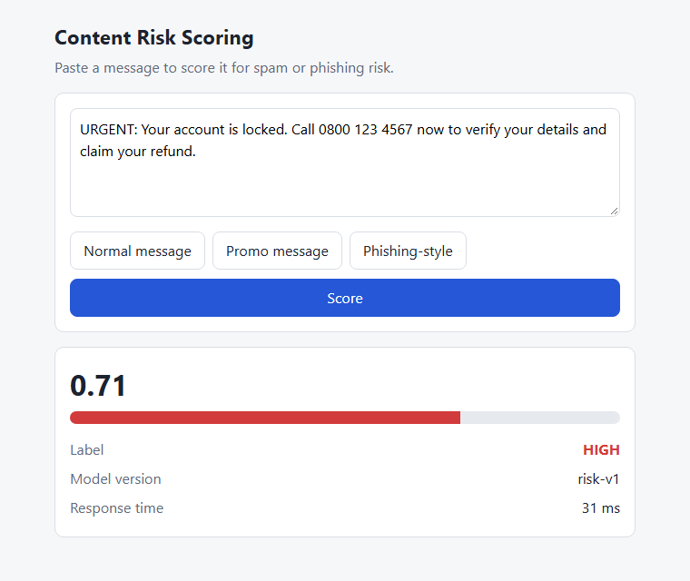

# Content Risk Scoring Service

English | [日本語](README.ja.md)

[](https://github.com/Karthik0000007/Risk_Scoring_System/actions/workflows/ci.yml)
[](https://www.python.org/downloads/release/python-3110/)
[](https://fastapi.tiangolo.com/)
[](https://www.docker.com/)
[](https://kubernetes.io/)
[](https://prometheus.io/)

A small FastAPI service that scores a text message for spam or phishing risk. `POST /score` returns a risk score between 0 and 1 from a TF-IDF + logistic regression model trained on the SMS Spam Collection dataset. If a prediction fails, the service answers with keyword rules and marks the response `degraded: true` instead of returning a 500. If the model never loaded, `/readyz` and `/score` return 503 so no traffic is sent to that instance. It ships with a one-page web UI, Prometheus metrics, a Dockerfile, a Docker Compose setup with Prometheus, Kubernetes manifests and a GitHub Actions CI pipeline.



---

## Contents

- [Quick start](#quick-start)
- [API](#api)
- [The model](#the-model)
- [Failure behaviour](#failure-behaviour)
- [Design decisions](#design-decisions)
- [Performance](#performance)
- [What I would improve next](#what-i-would-improve-next)
- [Project layout](#project-layout)
- [日本語の概要](#日本語の概要)

---

## Quick start

Requires Docker with Compose v2.

```bash
docker compose up --build
```

| Service | URL | What it is |
| :--- | :--- | :--- |
| `app` | [http://localhost:8000](http://localhost:8000) | Scoring API and the one-page UI |
| `prometheus` | [http://localhost:9090](http://localhost:9090) | Prometheus, scraping the app every 5s |

The `app` container's healthcheck calls `/readyz`, so `docker compose ps` shows it as `healthy` only once the model is loaded. Prometheus starts after that. Stop with `Ctrl+C`, then `docker compose down`.

### Without Docker

```bash
python -m venv .venv
source .venv/bin/activate          # Windows PowerShell: .\.venv\Scripts\Activate.ps1
pip install -r requirements.txt
uvicorn app.main:app --port 8000
```

Then open [http://localhost:8000](http://localhost:8000), or:

```bash
curl -X POST http://localhost:8000/score \
     -H "Content-Type: application/json" \
     -d '{"content": "URGENT: Your account is locked. Call 0800 123 4567 now."}'
```

### Tests and lint

```bash
pip install -r requirements-dev.txt
ruff check .
pytest
```

CI ([`.github/workflows/ci.yml`](.github/workflows/ci.yml)) runs the same `ruff check` and `pytest` on every push and pull request, then builds the Docker image. Any failure fails the run.

### Kubernetes

The manifests in [`k8s/`](k8s/) create a `content-risk-staging` namespace, a one-replica Deployment (CPU 200m to 500m, memory 512Mi to 1Gi, liveness on `/healthz`, readiness on `/readyz`) and a ClusterIP Service on port 80. They use the local image `content-risk-scoring:latest`, so build it and load it into your cluster first (for example `kind load docker-image content-risk-scoring:latest`).

```bash
docker build -t content-risk-scoring:latest .
kubectl apply -f k8s/namespace.yaml -f k8s/deployment.yaml -f k8s/service.yaml
kubectl get pods -n content-risk-staging
```

---

## API

### `POST /score`

Request:

```json
{ "content": "Get 50% off all shoes this weekend only! Reply STOP to opt out." }
```

`content` must be a string of 1 to 5000 characters.

Response:

```json
{
  "risk_score": 0.6412835639663655,
  "risk_label": "HIGH",
  "model_version": "risk-v1",
  "degraded": false
}
```

| Field | Meaning |
| :--- | :--- |
| `risk_score` | Model probability that the text is spam, 0.0 to 1.0 |
| `risk_label` | `LOW` (< 0.3), `MEDIUM` (0.3 to 0.6), `HIGH` (> 0.6), or `UNKNOWN` if every scorer failed |
| `model_version` | `risk-v1`, or `keyword-fallback-1.0` when the fallback scored the text |
| `degraded` | `true` when the model failed and the fallback answered |

Status codes:

| Code | When | Body |
| :--- | :--- | :--- |
| `200` | Scored by the model, or by the fallback (`degraded: true`) | The response above |
| `422` | Invalid input: empty, over 5000 characters, missing `content`, or not JSON | FastAPI validation error, `{"detail": [...]}` |
| `503` | The model did not load at startup | `{"detail": "model not loaded"}` |

### Other endpoints

| Endpoint | Returns |
| :--- | :--- |
| `GET /` | The one-page UI ([`app/static/index.html`](app/static/index.html)), plain HTML/CSS/JS |
| `GET /healthz` | Always `200 {"status": "ok"}` while the process runs (liveness) |
| `GET /readyz` | `200 {"ready": true, "model_version": "risk-v1"}` when the model is loaded, else `503 {"ready": false, "reason": "..."}` |
| `GET /metrics` | Prometheus metrics, listed below |

| Metric | Type | Labels | Meaning |
| :--- | :--- | :--- | :--- |
| `http_requests_total` | Counter | `method`, `path`, `status` | Requests handled |
| `http_request_latency_seconds` | Histogram | `path` | Request duration |
| `predictions_total` | Counter | `label` | `/score` responses by risk label |
| `fallback_total` | Counter | none | Requests the keyword fallback scored because the model raised |
| `model_loaded` | Gauge | none | `1` if the model loaded at startup, else `0` |

`path` is the route template (for example `/score`), never the raw URL, so label cardinality stays bounded. Unknown URLs are labelled `unmatched`, and requests to `/metrics` are not counted. Logs are JSON lines on stdout.

---

## The model

[`training/train.py`](training/train.py) trains a scikit-learn pipeline: `TfidfVectorizer` (word 1 and 2 grams) followed by `LogisticRegression`. The data is the [SMS Spam Collection](https://archive.ics.uci.edu/dataset/228/sms+spam+collection) from UCI, with `spam` treated as risky. It uses a stratified 80/20 train/test split with a fixed seed (42).

```bash
# put the SMSSpamCollection file in data/ (git-ignored), then:
python training/train.py
```

It saves the fitted pipeline to `models/risk-v1.joblib` and its metadata to [`models/risk-v1.json`](models/risk-v1.json). Both are committed, so the service runs without retraining. The service reads the model path from `MODEL_PATH` (default `models/risk-v1.joblib`) and the version from the JSON file.

Results from `models/risk-v1.json` (spam class, 1,115-message test set):

| Version | Trained | Rows | Precision | Recall | F1 |
| :--- | :--- | ---: | ---: | ---: | ---: |
| `risk-v1` | 2026-11-25 | 5,574 | 1.00 | 0.75 | 0.86 |

In practice, the model flags no false positives on the test set but misses about one spam message in four (37 of 149 at its 0.5 cut-off). By the service's labels, 3 of the 966 normal test messages score `MEDIUM` or higher and none score `HIGH`. It only knows SMS-style spam: a bank phishing message with a link scores 0.31 (`MEDIUM`), and threatening text scores low because the dataset has none.

---

## Failure behaviour

| Failure | What the client sees | What metrics show |
| :--- | :--- | :--- |
| **Model fails to load** at startup (missing file, bad artifact, or `FAIL_MODEL_LOAD=true`) | Process stays up. `/healthz` 200. `/readyz` 503 with the reason. `/score` 503 `{"detail": "model not loaded"}`. Kubernetes and the Compose healthcheck treat the instance as not ready. | `model_loaded 0`; `http_requests_total{path="/score",status="503"}` rises; `predictions_total` does not change |
| **Prediction error** (the loaded model raises for a request) | `200` with a score from whole-word keyword rules, `model_version: "keyword-fallback-1.0"`, `degraded: true`. If the rules also fail: `risk_score: 0.5`, `risk_label: "UNKNOWN"`, `degraded: true`. The error is logged. | `fallback_total` rises; `predictions_total{label=...}` rises for the label returned; status stays `200` |
| **Bad input** (empty, over 5000 characters, missing field, not JSON) | `422` with FastAPI's validation details. The model is not called. | `http_requests_total{path="/score",status="422"}` rises; `predictions_total` does not change |

---

## Design decisions

**Why logistic regression.** TF-IDF + logistic regression trains in seconds, the model file is 1.3 MB, and one prediction takes about 5 ms. Its output is already a probability, so it becomes `risk_score` directly. Its weights per word or word pair can be inspected, so I can explain why a message scored high. With 5,574 labelled messages, a transformer such as BERT would add hundreds of MB to the image and far more CPU time per request for little gain. The cost is that it only learns patterns present in the SMS data.

**Why 200 + `degraded` instead of 500.** The caller sits in a content submission path. A 500 forces it to guess between blocking and allowing, and often to retry. If one prediction fails, a keyword-rule score is still a useful signal, and `degraded: true`, `model_version` and `fallback_total` make the lower quality visible to the caller and to monitoring. This only covers a model that is loaded but fails on one request. If the model never loaded, the service returns 503 rather than pretending to score.

**Why readiness and liveness are separate.** Liveness (`/healthz`) answers "is the process alive?" and readiness (`/readyz`) answers "can it score?". If liveness depended on the model, a bad model file would make Kubernetes restart the pod in a loop, and the reason would be lost with each restart. With them separate, the pod stays up but receives no traffic, and `/readyz`, the logs and `model_loaded` all show why.

More detailed decision records are in [`design/`](design/), starting from [`design/INTERVIEW_MAP.md`](design/INTERVIEW_MAP.md).

---

## Performance

[`scripts/loadtest.py`](scripts/loadtest.py) sends N requests to `POST /score` at a fixed concurrency, cycling through five example messages, and prints count, errors, p50/p95/p99 latency and requests per second. It uses only `httpx` and `asyncio`.

```bash
python scripts/loadtest.py -n 1000 -c 10
```

| Setup | Concurrency | Requests | Errors | p50 (ms) | p95 (ms) | p99 (ms) | Req/s |
| :--- | ---: | ---: | ---: | ---: | ---: | ---: | ---: |
| Local uvicorn, 1 worker | 1 | 1000 | 0 | 4.67 | 5.85 | 7.15 | 196.5 |
| Local uvicorn, 1 worker | 10 | 1000 | 0 | 34.18 | 42.36 | 60.10 | 266.9 |
| `docker compose up` | 1 | 1000 | 0 | 5.86 | 12.83 | 27.74 | 141.4 |
| `docker compose up` | 10 | 1000 | 0 | 31.78 | 58.47 | 140.28 | 270.5 |

**Measured on:** Intel Core i5-12500H (12 cores, 16 threads), 8 GB RAM, Windows 11, Python 3.11.7, model `risk-v1`, with the load generator on the same machine. The Docker rows use Docker Desktop 29.2 (WSL 2 backend, no CPU limit on the container). These are single runs on a laptop, not a benchmark.

Local uvicorn at concurrency 10 meets the 50 ms p95 target (42 ms). Inside Docker it does not: p95 was 58 ms in the run above and ranged from 46 to 76 ms over four runs, and p99 is noisier still. With one worker, requests queue for the CPU, so latency grows with concurrency.

On Windows, use `127.0.0.1` (the script's default) rather than `localhost` when testing the container: `localhost` can go through Docker Desktop's IPv6 port proxy, which added about 50 ms to every request in my runs.

---

## What I would improve next

- **Better training data.** Add a phishing dataset with links and tune the decision threshold or class weights, so that recall rises above 0.75 and URL-based phishing scores high.
- **Tail latency under load.** Run several uvicorn workers or replicas (with a Kubernetes HorizontalPodAutoscaler) to bring p95 inside Docker under 50 ms at concurrency 10.
- **Alerting and a model gate in CI.** Add Prometheus alert rules for `model_loaded == 0`, a rising fallback rate and p95 latency, and fail CI if a retrained model's F1 drops below the current one.

---

## Project layout

```text
app/
  api/score.py          POST /score: model, keyword fallback, 503 when not loaded
  core/                 JSON logging and Prometheus metric definitions
  models/loader.py      ModelLoader (joblib + JSON metadata) and KeywordFallback
  schemas/score.py      request and response models
  static/index.html     one-page UI served at GET /
  health.py             /healthz and /readyz
  main.py               app setup, lifespan model loading, GET /
  middleware.py         request metrics and logs per route template
training/train.py       offline training script
models/                 risk-v1.joblib and risk-v1.json (committed)
scripts/loadtest.py     latency and throughput test
tests/                  pytest suite (API, fallback, loader, readiness, metrics, UI, training, load test)
design/                 design decision records
k8s/                    namespace, deployment, service
prometheus/             Prometheus scrape config for Docker Compose
docs/screenshot.png     screenshot used in this README
Dockerfile, docker-compose.yml, requirements.txt, requirements-dev.txt, pyproject.toml
```

---

## 日本語の概要

このプロジェクトは、テキストがスパムやフィッシングかどうかを判定する API です。FastAPI で作り、Docker や Kubernetes で動かすことができます。モデルは SMS のデータで学習したロジスティック回帰で、0 から 1 までのリスクスコアを返します。予測中にエラーが起きたときは、キーワードのルールで答えを返し、`degraded: true` と表示します。モデルが読み込めないときは `/readyz` が 503 を返すので、そのサーバーにはリクエストが送られません。リクエスト数や応答時間は Prometheus で確認できます。

日本語の詳しい説明は [README.ja.md](README.ja.md) にあります。
